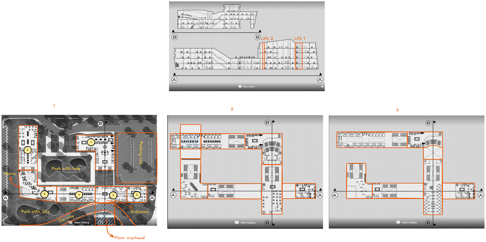
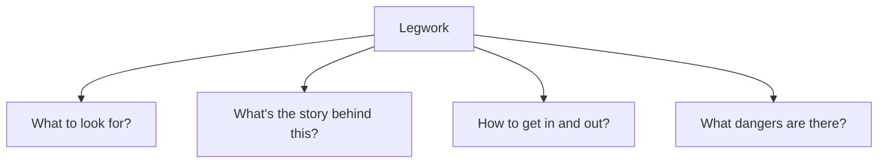
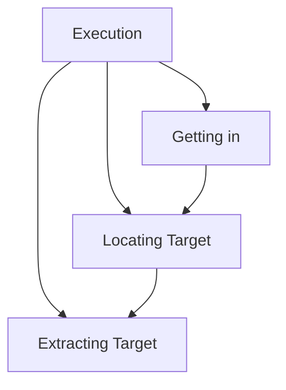

# Specifications
Floor: 3
Rooms: Around 15 relevant
Length:
Width:
Height:

# Map

# Occupants
!!! Research Institute is a huge research center owned by Proteus AG. Proteus only utilizes the <u>first floor</u> for its Contract Development and Manufacturing Operations services. The <u>second floor</u> and <u>third floor</u> is leased out to <u>Libertech Bio</u>. There is a <u>Renraku service center</u> on the third floor.
- **Proteus AG**
  A company !!!
- **First Floor**
  Entrance, CDMO center, receptionist, !!!
- **Libertech Bio**
  A company !!!
- **Second Floor**
  Stairs, elevators, !!!
- **Third Floor**
  Stairs, elevators, !!!
- **Renraku Service Center**
  Both Proteus AG and Liberta Bio utilize Renraku's software and matrix services for drug discovery and clinical trial design

--------
Draft
Dwellers ideas
- Receptionist
- A notable researcher (Liberta Bio)
- A notable researcher (Proteus AG)
- Admin person
- Lab manager
- Janitor/cleaner

Research facility conditions:
- On lockdown

Game flow in general

Retrieving the target

Complications
<u>During negotiation</u>
- Mr. Johnson lacking useful info
- Mr. Johnson doesn't like them
- Time limit
- Unsafe meeting location

<u>During the run</u>
- Running into Renraku agents
- The monster roaming
- Power outage(?)
- Physical mana barriers
- Obstructive admin/receptionist
